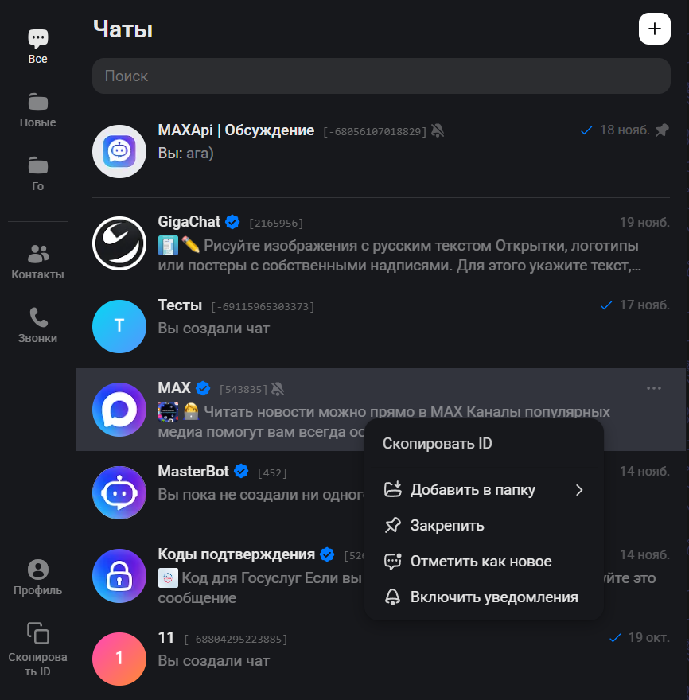

# MAX - Показать ID чатов и контактов

Этот userscript для Tampermonkey добавляет отображение ID чатов, контактов и профиля в веб-версии MAX. Скрипт помогает быстро увидеть идентификатор рядом с названием чата и скопировать его без ручного поиска в интерфейсе.

## ✨ Возможности

- Отображение ID чатов рядом с названиями в списке.
- Отображение ID контактов рядом с именами.
- Кнопка копирования ID через контекстное меню.
- Кнопка копирования ID профиля в интерфейсе MAX.
- Получение ID из WebSocket-сообщений, URL и сетевых запросов.
- Работа с динамически обновляемым интерфейсом `https://web.max.ru/*`.

## 🚀 Быстрый старт

У проекта нет отдельной команды запуска из терминала. Использование выполняется через Tampermonkey:

1. Установите расширение [Tampermonkey](https://www.tampermonkey.net/).
2. Создайте новый скрипт в Tampermonkey.
3. Вставьте содержимое файла `max-chat-id-display.user.js`.
4. Сохраните скрипт.
5. Откройте веб-версию MAX по адресу `https://web.max.ru/`.

## 📁 Структура проекта

- `max-chat-id-display.user.js` — основной userscript.
- `image.png` — скриншот работы скрипта.
- `README.md` — описание проекта.

## 🛠 Использование

После установки скрипт автоматически:

- перехватывает `WebSocket` и `fetch`;
- отслеживает переходы по `history.pushState`, `history.replaceState` и `popstate`;
- добавляет подпись вида `[ID]` рядом с чатом или контактом;
- показывает кнопку `Скопировать ID` в контекстном меню;
- добавляет кнопку для копирования ID профиля.

Если ID не удалось получить сразу, в проекте предусмотрен резервный сценарий: он может появиться после открытия чата, когда в URL становится доступен идентификатор.

## 🧪 Технологии

- JavaScript
- Tampermonkey
- DOM API
- WebSocket API
- Fetch API

## ⚠️ Важно

В исходной документации проекта указано, что использование скрипта выполняется на собственный риск. Изменения в интерфейсе MAX могут повлиять на работу селекторов и механизма извлечения ID.

---

Автор: legenda  
Telegram: [@LEGENDA_SD](https://t.me/LEGENDA_SD)
